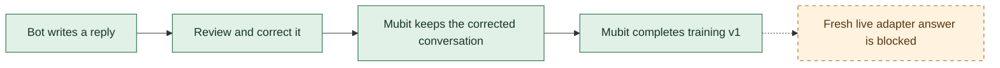

# Prove a correction becomes a model update

Track: **Recurring tasks**. Almost Human repeatedly generates short NPC dialogue. Players expose awkward replies, a reviewer supplies a better reply, and the intended Mubit loop trains a reusable model for that task. The game is the feedback environment; better dialogue for game developers is the proposed benefit. A user study or measured quality comparison is still needed to substantiate that benefit.

The runner captures inference and conversational corrections; console review has
now produced a completed synthetic training run. **Live adapter inference and
quality improvement remain unverified.** See [the run report](../../MUBIT_TRAINING_RUN.md)
for its failed evaluation and serving blocker. The runner itself does not call a
replacement-target API, rate examples, start jobs or select adapters.

## Conversational-correction experiment

The hosted feedback editor exposes Good/Bad and Comment, without a replacement-answer
field. A separate, explicit experiment uses ordinary conversational feedback:

1. Capture a synthetic game answer with the frozen production system prompt.
2. Send that answer plus an editorial correction as the next user turn through
   the same Mubit gateway. Keep the system instructions unchanged.
3. Review the resulting answer and, if suitable, rate **that corrected call**
   Good in the console. The runner never rates answers automatically.
4. Verify that the corrected call is kept, appears in the training dataset,
   and contributes to the completed adapter version before claiming training.

This is a corrected conversation, **not** an API that replaces the original
call's answer. The trace's separate `feedback.correction` field remains null.
An accepted rating alone does not prove dataset inclusion or a model update.

```sh
nix develop -c python3 scripts/mubit-learning-proof.py revise candidate-01 \
  --feedback 'Give a specific unusual talent, in seven words or fewer.'
```

The original receipt is preserved; the revised receipt links to it and records
the exact feedback, unchanged prompt hash, and returned answer. This uses the
same persistent three-attempt discovery ledger. Evaluation cases cannot be revised.

For an explicitly authorized training experiment, prepare a separate bounded
batch without resetting discovery receipts:

```sh
nix develop -c node scripts/prepare-learning-proof.mjs --training-batch
nix develop -c python3 scripts/mubit-learning-proof.py \
  --directory artifacts/learning-training-batch capture-batch
```

This freezes 40 distinct synthetic candidates and four held-out questions with
a 44-request maximum. Capture sends candidates only, skips every already-reserved
case on continuation, and stops after three failures in one run. Failed calls
remain counted and are not retried. Every returned answer requires editorial
review before a Good rating. Keep lessons disabled and evaluation capture off.
The batch and all model receipts remain under ignored `artifacts/`.

## Simple flow



Green: exercised with synthetic examples and service evidence. Amber: blocked
by the current evaluation/serving state. Exact training-row membership remains
inferred because the full dataset manifest was not exposed.

## Run the local experiment

Use Node.js 22 and Python 3. Nix is the repository default:

```bash
nix develop -c npm --prefix backend ci
nix develop -c node scripts/prepare-learning-proof.mjs
python3 scripts/mubit-learning-proof.py status
```

In a managed environment without Nix, use the project-local Node 22 runtime and dependencies described in `AGENTS.md`. This work was checked with Node 22.23.4 and Python 3; Nix did not run. An existing manifest is intentionally not overwritten. Continue an existing experiment rather than resetting it.

The preparation command imports the real `buildBotMessages` function. It freezes the source commit, identical system instructions, six synthetic candidate conversations, and four separate evaluation conversations. Prompt lessons are empty so they cannot explain a supposed training improvement. Nothing is sent during preparation.

With the environment's configured `MUBIT_API_KEY`:

```bash
python3 scripts/mubit-learning-proof.py generate candidate-01 --capture-training-candidate
python3 scripts/mubit-learning-proof.py correct candidate-01 \
  --replacement 'a specific reviewed reply goes here' \
  --reason 'Explain the observed problem and why this replacement addresses it.'
python3 scripts/mubit-learning-proof.py generate eval-01
python3 scripts/mubit-learning-proof.py report
```

Replace the sample correction with an actual editorial review of the returned reply. `--capture-training-candidate` allows storage of that synthetic candidate; it does not establish that Mubit kept it for training. Evaluation requests always send `x-middleware-record: off` and cannot be corrected or captured by this runner.

The discovery experiment has a persistent three-attempt limit, counts failures, and never automatically retries a case. It is deliberately too small to manufacture a training batch before the submission contract is verified. Training at a larger scale needs a separate implementation and explicit experiment design; do not delete the ledger to continue. Keep all generated files under the ignored `artifacts/learning-proof/` directory.

The generated report includes original/replacement text, request IDs, prompt hashes, timings, and the demo outline. `correction-review.json` is a **local review format, not a supported Mubit upload payload**. All training and adapter status fields remain unverified until a future implementation records service evidence. Editing local status fields cannot prove training.

## Earlier discovery experiment and access blocker

The earlier managed-environment experiment on 2026-10-25 made two live calls:
one recorded synthetic candidate and one evaluation request with recording
disabled. Its local replacement correction was not submitted. The later local
conversational-correction experiment and completed training are documented above
and in the run report; they do not retroactively prove a replacement-target API.

The managed environment permits `api.mubit.ai`, but excludes `app.mubit.ai`. A request to the dashboard failed at the network proxy with HTTP 403 before reaching the application. This task has no attached signed-in browser-control session. Its configured inference credential is scoped to `api.mubit.ai`; it is not a dashboard/admin credential. Dashboard inspection therefore remains blocked. Do not copy login cookies into chat or repurpose the inference key against an admin endpoint.

## Replacement-target API verification (still separate)

Once dashboard access is available:

1. Find the request ID from `receipts/candidate-01.json` in the correct workspace/project. Confirm which task received it; use the prompt fingerprint to check the instructions are unchanged.
2. Inspect the current feedback editor and example detail. Establish whether it accepts **replacement reply text** and whether the kept training target contains that exact text. A Bad rating plus a free-text comment is insufficient. Record the accepted example ID, target text/hash, task ID and timestamp. If the dashboard only supports selection ratings, keep the correction path marked blocked until a supported way to submit a replacement is established.
3. Inspect training permissions, thresholds and current task status. Official documentation describes training enabled for the workspace and a default threshold of 25 **kept** examples; raw requests and rejected examples do not count. Thresholds may vary with workspace policy. Do not send repeated copies of one answer to meet the threshold.
4. After confirming the submission contract, implement submission and record the real accepted/rejected result. Gather sufficient independently reviewed, consented examples for the same task. Store the exact task/dataset lineage of the resulting training job.
5. Wait for a completed adapter version and inspect its evaluation. In the documented console comparison, select the passed adapter and compare it with the provider on the frozen evaluation inputs. Leave training capture off and prompt lessons empty. Preserve version IDs and response provenance. A completed job alone does not show that the game uses it.
6. Verify a new game reply was actually served by that version using the supported routing mechanism and service evidence. Do not invent an adapter model ID. If only console inference works, label the demo as a console adapter test and keep game integration pending.

Official references: [first adapter](https://docs.mubit.ai/guides/first-adapter), [model IDs and comparisons](https://docs.mubit.ai/guides/model-ids), [task and session grouping](https://docs.mubit.ai/guides/tasks-and-sessions). These references do not establish a public corrected-example submission API. The old console route is undocumented; see `MUBIT_VERIFICATION.md` and the caveat in `MUBIT_LEARNING.md`.

## Evidence for all four judging criteria

| Criterion | Demo evidence | Current gap |
| --- | --- | --- |
| Use of Mubit | Accepted conversational correction → completed version → fresh live answer from that version | Correction accepted and job completed; live adapter serving blocked |
| Usefulness | Repeated NPC dialogue; show how developer review improves a recurring player experience | Quality/user-benefit measurement pending |
| Technical execution | Real game prompts, durable receipts, reviewed synthetic data, separate evaluation cases, visible failures | Dialogue grading and trained-model serving need repair |
| Demo | One clear game exchange, correction, completed version and fresh live answer | Live inference remains blocked; do not substitute a provider reply |

Compare provider and adapter on the **same** held-out inputs. Blindly score each for relevance, naturalness, and the game's short-reply constraints. Report the number of examples, wins/ties/losses, failures, latency and measured cost when available. A small sample is exploratory; do not claim a statistically established improvement. Existing player votes with prompt lessons enabled cannot isolate the effect of adapter training.

The submission video has a hard two-minute / 300 MB limit. Use the current
[1:45–1:50 recording plan](../../judging/DEMO.md) and
[submission checklist](../../judging/SUBMISSION.md). Training shown from saved
receipts must be labelled as recorded; live adapter inference remains unverified.

## Local checks

```bash
python3 -m unittest discover -s scripts -p 'test_learning_proof.py' -v
nix develop -c npm --prefix backend test
nix develop -c npm --prefix backend run check
nix develop -c npm --prefix backend run build:playtest
nix develop -c node --experimental-strip-types scripts/check-shared-contract.mjs
```

These checks validate local behavior, not remote correction acceptance or training. No shared deployment or rating/training policy change is required to run them.
