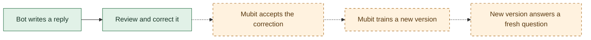

# Prove a correction becomes a model update

Track: **Recurring tasks**. Almost Human repeatedly generates short NPC dialogue. Players expose awkward replies, a reviewer supplies a better reply, and the intended Mubit loop trains a reusable model for that task. The game is the feedback environment; better dialogue for game developers is the proposed benefit. A user study or measured quality comparison is still needed to substantiate that benefit.

The runner currently verifies inference and prepares local corrections. It **does not submit corrections, start training, select an adapter, or prove improvement**. Those stages require a verified Mubit interface. Do not present this preparation as a finished learning loop.

## Simple flow



Green: exercised with synthetic examples. Amber: needs service evidence. A successful provider response or a Good/Bad rating alone does not verify the amber steps.

## Run the local experiment

Use Node.js 22 and Python 3. Nix is the repository default:

```bash
nix develop -c npm --prefix backend ci
nix develop -c node scripts/prepare-learning-proof.mjs
python3 scripts/mubit-learning-proof.py status
```

In a managed environment without Nix, use the project-local Node 22 runtime and dependencies described in `AGENTS.md`. This work was checked with Node 22.23.4 and Python 3; Nix did not run. An existing manifest is intentionally not overwritten. Continue an existing experiment rather than resetting it.

The preparation command imports the real `buildBotMessages` function. It freezes the source commit, identical system instructions, six synthetic candidate conversations, and four separate evaluation conversations. Prompt lessons are empty so they cannot explain a supposed training improvement. Nothing is sent during preparation.

With the environment's configured `MUBIT_API_KEY`:

```bash
python3 scripts/mubit-learning-proof.py generate candidate-01 --capture-training-candidate
python3 scripts/mubit-learning-proof.py correct candidate-01 \
  --replacement 'a specific reviewed reply goes here' \
  --reason 'Explain the observed problem and why this replacement addresses it.'
python3 scripts/mubit-learning-proof.py generate eval-01
python3 scripts/mubit-learning-proof.py report
```

Replace the sample correction with an actual editorial review of the returned reply. `--capture-training-candidate` allows storage of that synthetic candidate; it does not establish that Mubit kept it for training. Evaluation requests always send `x-middleware-record: off` and cannot be corrected or captured by this runner.

The discovery experiment has a persistent three-attempt limit, counts failures, and never automatically retries a case. It is deliberately too small to manufacture a training batch before the submission contract is verified. Training at a larger scale needs a separate implementation and explicit experiment design; do not delete the ledger to continue. Keep all generated files under the ignored `artifacts/learning-proof/` directory.

The generated report includes original/replacement text, request IDs, prompt hashes, timings, and the demo outline. `correction-review.json` is a **local review format, not a supported Mubit upload payload**. All training and adapter status fields remain unverified until a future implementation records service evidence. Editing local status fields cannot prove training.

## Current evidence and access blocker

On 2026-10-25, two live Mubit calls succeeded: one recorded synthetic candidate and one evaluation request with recording disabled. One reviewed correction is saved locally and has not been submitted. Receipts, response text, timings, and the correction are in the ignored report directory; no model data or player conversations are committed here.

The managed environment permits `api.mubit.ai`, but excludes `app.mubit.ai`. A request to the dashboard failed at the network proxy with HTTP 403 before reaching the application. This task has no attached signed-in browser-control session. Its configured inference credential is scoped to `api.mubit.ai`; it is not a dashboard/admin credential. Dashboard inspection therefore remains blocked. Do not copy login cookies into chat or repurpose the inference key against an admin endpoint.

## Finish verification in the signed-in dashboard

Once dashboard access is available:

1. Find the request ID from `receipts/candidate-01.json` in the correct workspace/project. Confirm which task received it; use the prompt fingerprint to check the instructions are unchanged.
2. Inspect the current feedback editor and example detail. Establish whether it accepts **replacement reply text** and whether the kept training target contains that exact text. A Bad rating plus a free-text comment is insufficient. Record the accepted example ID, target text/hash, task ID and timestamp. If the dashboard only supports selection ratings, keep the correction path marked blocked until a supported way to submit a replacement is established.
3. Inspect training permissions, thresholds and current task status. Official documentation describes training enabled for the workspace and a default threshold of 25 **kept** examples; raw requests and rejected examples do not count. Thresholds may vary with workspace policy. Do not send repeated copies of one answer to meet the threshold.
4. After confirming the submission contract, implement submission and record the real accepted/rejected result. Gather sufficient independently reviewed, consented examples for the same task. Store the exact task/dataset lineage of the resulting training job.
5. Wait for a completed adapter version and inspect its evaluation. In the documented console comparison, select the passed adapter and compare it with the provider on the frozen evaluation inputs. Leave training capture off and prompt lessons empty. Preserve version IDs and response provenance. A completed job alone does not show that the game uses it.
6. Verify a new game reply was actually served by that version using the supported routing mechanism and service evidence. Do not invent an adapter model ID. If only console inference works, label the demo as a console adapter test and keep game integration pending.

Official references: [first adapter](https://docs.mubit.ai/guides/first-adapter), [model IDs and comparisons](https://docs.mubit.ai/guides/model-ids), [task and session grouping](https://docs.mubit.ai/guides/tasks-and-sessions). These references do not establish a public corrected-example submission API. The old console route is undocumented; see `MUBIT_VERIFICATION.md` and the caveat in `MUBIT_LEARNING.md`.

## Evidence for all four judging criteria

| Criterion | Demo evidence | Current gap |
| --- | --- | --- |
| Use of Mubit | Exact accepted correction → completed version → fresh answer from that version | All three service stages unverified |
| Usefulness | Repeated NPC dialogue; show how developer review improves a recurring player experience | Quality/user-benefit measurement pending |
| Technical execution | Real game prompts, durable request receipts, consent rules, separate evaluation cases, visible failures | Submission and trained-model serving pending |
| Demo | One clear game exchange, correction, completed version and fresh live answer | Rehearsal waits on the working training path |

Compare provider and adapter on the **same** held-out inputs. Blindly score each for relevance, naturalness, and the game's short-reply constraints. Report the number of examples, wins/ties/losses, failures, latency and measured cost when available. A small sample is exploratory; do not claim a statistically established improvement. Existing player votes with prompt lessons enabled cannot isolate the effect of adapter training.

Suggested 2:30 demo (adjust to the event's actual limit):

| Time | Show |
| --- | --- |
| 0:00–0:25 | One game exchange and the recurring NPC-dialogue problem |
| 0:25–0:55 | Original reply, reviewed replacement, and accepted training target |
| 0:55–1:25 | Completed version linked to the correction; disclose that training happened earlier |
| 1:25–2:05 | Fresh live question answered by the trained version, with provenance |
| 2:05–2:30 | Small honest comparison and remaining limitations |

## Local checks

```bash
python3 -m unittest discover -s scripts -p 'test_learning_proof.py' -v
nix develop -c npm --prefix backend test
nix develop -c npm --prefix backend run check
nix develop -c npm --prefix backend run build:playtest
nix develop -c node --experimental-strip-types scripts/check-shared-contract.mjs
```

These checks validate local behavior, not remote correction acceptance or training. No shared deployment or rating/training policy change is required to run them.
